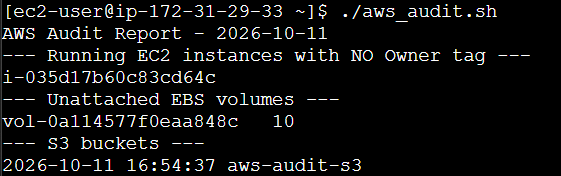

# AWS Resource Auditor

A Bash script that finds resources in AWS that may be wasting money.

## What it checks (v0.1)
- Running EC2 instances missing an Owner tag (case sensitive)
- Unattached EBS volumes (status = available)
- S3 buckets (listed only)

## Prerequisites
- AWS CLI installed
- jq installed (sudo apt install -y jq)
- AWS credentials with **read-only** permissions:
  - On an EC2 instance: attach an IAM role (no access keys needed)
- Minimum permissions: AmazonEC2ReadOnlyAccess and AmazonS3ReadOnlyAccess

## Usage
```bash
chmod +x aws_audit.sh
./aws_audit.sh
```
The report is saved in ./reports/audit_<date>.txt. 

## Sample output


## limitations
- Checks only one region (ap-south-1)
- S3 buckets are only listed, not checked for being abandoned.
